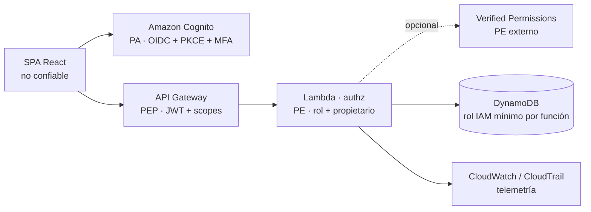

# Guía paso a paso — Plan de tareas con GitHub Spec Kit

**Proyecto:** ZeroTrust_Lab04 — Plataforma de Donaciones Seguras (Fundación AQP-SOLIDARIA)
**Entradas:** [requirements.md](./requirements.md) · [design.md](./design.md)
**Salida esperada:** `.specify/memory/constitution.md`, `specs/001-*/spec.md`, `plan.md`, `tasks.md`
**Evidencias:** guardar cada captura en `evidence/speckit/NN-nombre.png`

> Entorno de referencia: Windows 11 + PowerShell, `uv` instalado, Claude Code como agente.

---

## 0. Arquitectura de referencia (diapositiva del curso)

Fuente: «Ejemplo aplicado: AWS Free plan — Cómo se ve ZTA en el laboratorio de donaciones simuladas».



| Componente | Rol NIST SP 800-207 | Historias |
|---|---|---|
| SPA React | Sujeto no confiable | HU-01..HU-09, RNF-HU-06, RNF-HU-11 |
| Amazon Cognito | Policy Administrator (PA) | HU-03, HU-11 |
| API Gateway HTTP API | Policy Enforcement Point (PEP) | CA-03.2, CA-NF02.1 |
| Lambda `authz` | Policy Engine (PE) embebido | HU-04, HU-07, HU-08 |
| Verified Permissions | PE externo (extensión) | HU-12 |
| DynamoDB | Recurso, IAM mínimo por función | RNF-HU-03, RNF-HU-04 |
| CloudWatch / CloudTrail | Telemetría | RNF-HU-07 |

- **Cubierto:** identidad fuerte, autorización por recurso, mínimo privilegio, integridad.
- **Fuera de alcance (declarar):** postura del dispositivo, evaluación continua, ZTNA.

Coincide con `design.md` §3 y §6.1; no requiere cambios de diseño.

---

## A. Agent Toolkit for AWS (MCP + skills) — antes de Spec Kit

Fuente: https://raw.githubusercontent.com/aws/agent-toolkit-for-aws/refs/heads/main/setup-instructions/setup.md
Datos: perfil `zerotrust-lab04` · Region del proyecto `us-east-2` · new AWS experience.
El servicio Agent Toolkit solo existe en `us-east-1`: los pasos A4 y A5 usan `us-east-1`; los recursos del laboratorio van en `us-east-2`.
Nunca se usan access keys: `aws login` entrega credenciales de 12 h, renovables 90 días sin navegador.

### A1. Instalar AWS CLI v2 (PowerShell, no cmd.exe)

```powershell
$env:OS
aws --version   # esperado: no reconocido
irm 'https://awscli.amazonaws.com/v2/install.ps1' | iex
```

Cerrar y reabrir PowerShell, luego `aws --version` (debe mostrar `aws-cli/2.x`).

📸 **Captura A1** — `evidence/aws-toolkit/A1-aws-cli.png`

### A2. Iniciar sesión (navegador)

Confirmar la Region en AWS Settings > View all projects > Overview > Additional Info > Region (debe decir `us-east-2`).

```powershell
aws configure set region us-east-2 --profile zerotrust-lab04
aws login --region us-east-2 --profile zerotrust-lab04
```

Completar el inicio de sesión en el navegador. Sin navegador disponible: añadir `--remote`.

📸 **Captura A2** — `evidence/aws-toolkit/A2-login.png`

### A3. Verificar identidad

```powershell
aws sts get-caller-identity --profile zerotrust-lab04
aws freetier get-account-plan-state --profile zerotrust-lab04
```

Debe devolver `Account`, `Arn`, `UserId` y `accountPlanType: FREE`. **Tapar el Account ID en la captura.**

📸 **Captura A3** — `evidence/aws-toolkit/A3-identidad.png`

### A4. Configurar Agent Toolkit (wizard interactivo)

```powershell
aws configure agent-toolkit --region us-east-1 --profile zerotrust-lab04
```

Seleccionar **Claude Code** cuando el wizard pregunte por las herramientas.

📸 **Captura A4** — `evidence/aws-toolkit/A4-wizard.png`

**Corrección obligatoria (la hace Claude Code):** el wizard crea la entrada `aws-mcp` sin perfil, así que usa `default` y falla con el error `-32602 Invalid request parameters`. Hay que añadir esto a la entrada `aws-mcp`:

```json
"env": { "AWS_MCP_PROXY_PROFILES": "zerotrust-lab04" }
```

### A5. Verificar skills disponibles

```powershell
aws agent-toolkit list-available-skills --region us-east-1 --profile zerotrust-lab04
```

Debe devolver un JSON con `name`, `description`, `skillVersion` y `categories`.

📸 **Captura A5** — `evidence/aws-toolkit/A5-skills.png`

### A6. Reglas AWS en `CLAUDE.md`

Ya creado en la raíz del repo, con las reglas de la new AWS experience entre `<!-- BEGIN/END AWS Agent Toolkit rules -->`. Reiniciar Claude Code y ejecutar `/mcp`: `aws-mcp` debe aparecer como conectado.

📸 **Captura A6** — `evidence/aws-toolkit/A6-mcp-conectado.png`

---

## 1. Verificar prerrequisitos

```powershell
uv --version
git --version
node --version
claude --version
```

📸 **Captura 01** — `evidence/speckit/01-prerrequisitos.png`

## 2. Comprobar que Spec Kit no está instalado

```powershell
specify version
uv tool list
```

Resultado esperado: `specify` no se reconoce y `No tools installed`.

📸 **Captura 02** — `evidence/speckit/02-sin-speckit.png`

## 3. Instalar Spec Kit globalmente

```powershell
uv tool install specify-cli --from git+https://github.com/github/spec-kit.git
specify version
specify check
```

`specify check` lista las herramientas detectadas (git, claude, etc.).

📸 **Captura 03** — `evidence/speckit/03-instalacion.png`

> Actualizar después: `uv tool install specify-cli --force --from git+https://github.com/github/spec-kit.git`

## 4. Inicializar Spec Kit en el repositorio

Desde la raíz del repo:

```powershell
cd C:\Users\andre\Documentos\TAIS\TIAS_ZEROTRUST
specify init --here --ai claude --script ps
```

- `--here`: usa la carpeta actual (ya contiene requirements.md y design.md). Pedirá confirmación porque no está vacía; responder `y` (o añadir `--force`).
- `--ai claude`: genera los comandos `/speckit.*` en `.claude/commands/`.
- `--script ps`: scripts PowerShell (Windows).

```powershell
git status
tree /F .specify .claude
```

📸 **Captura 04** — `evidence/speckit/04-init.png`

```powershell
git add .
git commit -m "chore: initialize spec-kit for claude"
```

## 5. Abrir Claude Code y confirmar comandos

```powershell
claude
```

Dentro de Claude Code escribir `/speckit` y verificar que aparecen: `constitution`, `specify`, `clarify`, `plan`, `tasks`, `analyze`, `implement`.

📸 **Captura 05** — `evidence/speckit/05-comandos.png`

## 6. Constitución del proyecto

```text
/speckit.constitution Principios no negociables del proyecto ZeroTrust_Lab04 (ver requirements.md y design.md):
1. Zero Trust (NIST SP 800-207): cada solicitud protegida se autentica en API Gateway (JWT + scopes) y se autoriza en Lambda (rol + propietario); ninguna confianza por red ni por datos del navegador.
2. Backend autoritativo: identidad (sub) y roles (cognito:groups) solo desde claims verificados; montos en céntimos enteros, nunca float.
3. Donaciones simuladas: prohibido solicitar o almacenar tarjeta, CVV, cuenta bancaria o DNI.
4. Mínimo privilegio: un rol IAM por función Lambda, sin Action/Resource "*" injustificados, sin llaves AWS persistentes.
5. Integridad: idempotencia y transiciones con TransactWriteItems condicionado.
6. Pruebas primero en controles de seguridad: T01–T14 automatizadas o con evidencia; CI en verde en cada PR.
7. Restricciones: AWS Free plan, una región, IaC con AWS SAM, tokens en memoria, Tailwind (sin Bootstrap), sin secretos ni datos reales en el repo.
8. Trazabilidad: cada tarea y test referencia sus IDs HU/CA/RNF-HU.
```

📸 **Captura 06** — `evidence/speckit/06-constitution.png` (mostrar `.specify/memory/constitution.md`)

## 7. Especificación (qué y por qué)

```text
/speckit.specify Plataforma de Donaciones Seguras para la Fundación AQP-SOLIDARIA. Usa requirements.md como fuente única: roles Visitante/Donante/Gestor/Auditor, épicas EP-01..EP-04, historias HU-01..HU-12 con sus criterios CA-*, RNF-HU-01..RNF-HU-11, modelo de datos lógico y pruebas T01–T14. MVP: HU-01..HU-09, HU-11 y todos los RNF; extensión: HU-10 y HU-12. Conserva los identificadores originales para trazabilidad.
```

Spec Kit crea una rama `001-...` y `specs/001-*/spec.md`.

📸 **Captura 07** — `evidence/speckit/07-spec.png`

## 8. Aclaraciones (opcional, recomendado)

```text
/speckit.clarify
```

Responder las preguntas usando requirements.md; si algo no está definido, decidir en equipo y registrarlo.

📸 **Captura 08** — `evidence/speckit/08-clarify.png`

## 9. Plan técnico (cómo)

```text
/speckit.plan Usa design.md como fuente técnica y la arquitectura de referencia de GUIA_SPECKIT.md §0. Stack: TypeScript, React 19 + Vite 8 + Tailwind 4, React Router, React Hook Form + Zod (esquemas compartidos), TanStack Query, oidc-client-ts (Auth Code + PKCE, tokens en memoria); backend Node.js 24 en AWS Lambda con módulos projects/donations/authz/audit; API Gateway HTTP API con JWT authorizer y scopes; Cognito con grupos DONANTE/GESTOR/AUDITOR y MFA TOTP; DynamoDB on-demand (Projects, Donations, Idempotency, AuditEvents); S3 privado + CloudFront OAC + response headers policy; CloudWatch (14 días) + CloudTrail; AWS SAM con stage academic; Vitest + Testing Library + Bruno; ESLint + Prettier; GitHub Actions. Endpoints y modelo de datos según design.md §4–§5. Extensión: Verified Permissions + Cedar.
```

Genera `plan.md`, `research.md`, `data-model.md`, `contracts/` y `quickstart.md`.

📸 **Captura 09** — `evidence/speckit/09-plan.png`

## 10. Plan de tareas

```text
/speckit.tasks Organiza las tareas según el plan de 7 días de design.md §9 y los 5 roles (DevOps, Identidad/Seguridad, Backend, Frontend, QA/Docs). Cada tarea debe indicar día, rol responsable, archivos afectados, IDs HU/CA/RNF-HU y prueba T asociada. Marca con [P] las tareas paralelizables. Las pruebas de seguridad van antes de su implementación.
```

📸 **Captura 10** — `evidence/speckit/10-tasks.png` (mostrar `specs/001-*/tasks.md`)

## 11. Análisis de consistencia

```text
/speckit.analyze
```

Verifica coherencia entre spec, plan y tasks (cobertura de HU, T01–T14, contradicciones). Corregir los hallazgos críticos antes de implementar.

📸 **Captura 11** — `evidence/speckit/11-analyze.png`

## 12. Versionar y abrir PR

```powershell
git add .
git commit -m "docs: add spec-kit constitution, spec, plan and tasks"
git push -u origin HEAD
gh pr create --fill --base main
```

📸 **Captura 12** — `evidence/speckit/12-pr.png`

## 13. Implementación (siguiente fase)

```text
/speckit.implement
```

Ejecutar por fases/días, con PR revisado por otro integrante (design.md §10). Registrar el uso de Claude Code y Spec Kit en `AI_USAGE.md`.

---

## Registro de evidencias

| # | Paso | Archivo | Hecho |
|---|---|---|:---:|
| 01 | Prerrequisitos | `01-prerrequisitos.png` | ☐ |
| 02 | Sin Spec Kit | `02-sin-speckit.png` | ☐ |
| 03 | Instalación | `03-instalacion.png` | ☐ |
| 04 | `specify init` | `04-init.png` | ☐ |
| 05 | Comandos `/speckit` | `05-comandos.png` | ☐ |
| 06 | Constitución | `06-constitution.png` | ☐ |
| 07 | Especificación | `07-spec.png` | ☐ |
| 08 | Aclaraciones | `08-clarify.png` | ☐ |
| 09 | Plan técnico | `09-plan.png` | ☐ |
| 10 | Tareas | `10-tasks.png` | ☐ |
| 11 | Análisis | `11-analyze.png` | ☐ |
| 12 | PR | `12-pr.png` | ☐ |

> Capturas sanitizadas: sin tokens, correos reales, IDs de cuenta AWS ni llaves.
